<p align="center"><a href="README.zh-CN.md">简体中文</a> | <b>English</b></p>

<div align="center">
  
</div>

<div align="center">

# 🎨 nature-figure-skill

### A paper-figure studio in the browser — drag-and-drop templates, with an agent workflow as the power path

**Two routes, one destination: submission-grade figures.**
Don't want to write code? Open [FigureForge](figureforge/), the visual editor: 22 publication-grade templates and 16 curated palettes, arranged as easily as slides in PowerPoint.
Want full automation? Let your agent run the [nature-figure workflow](skills/nature-figure/SKILL.md): figure contract → single-backend rendering → independent exports, in both Python and R.

[](LICENSE)
[](https://jing1312.github.io/nature-figure-skill/figureforge/)
[](#-what-the-templates-look-like-real-renders)
[](#core-capabilities)
[](#-nature-figure--agent-skill-figure-workflow)

</div>

---

## ✨ What the templates look like (real renders)

Every image below is a **real output** of a built-in FigureForge template — not a mockup: pick a skeleton, swap in your data, export SVG / PNG / TIFF / PDF / PPTX in one click.

<div align="center">
  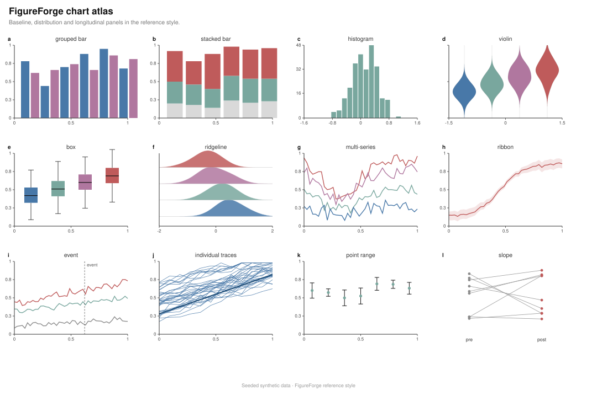
</div>

**Advanced charts** — omics-, cohort- and project-management-level figures, also out of the box:

<div align="center">
  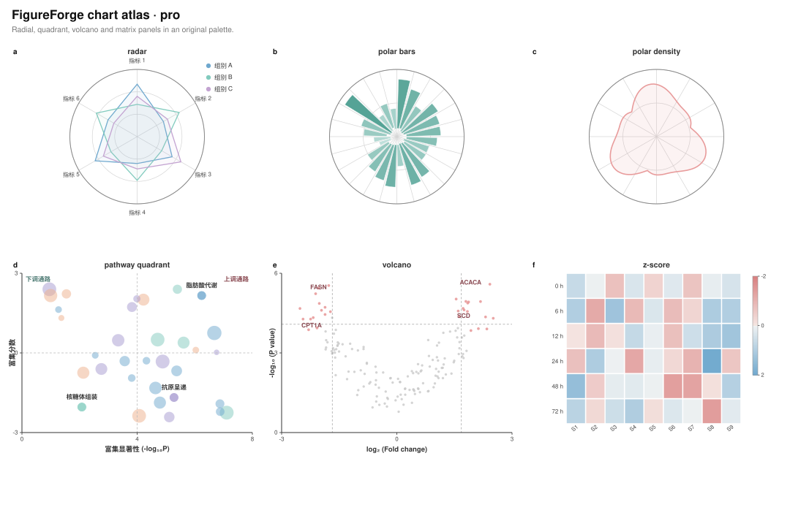
</div>

**Bioinformatics atlas** — dot-clustered heatmap, correlation matrix, ring heatmap, Mantel test, GSEA, PCA confidence ellipses, marginal-density scatter and other high-frequency bioinformatics figures, in NPG-style colors:

<div align="center">
  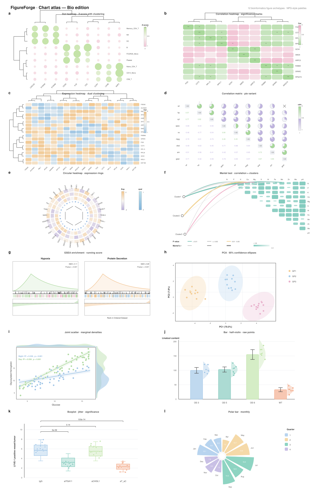
</div>

**Extra atlas (new)** — OncoPrint, waterfall, alluvial, ridgeline, Bland-Altman agreement, immune-composition stacked area, forest plot, Manhattan plot: 8 high-frequency clinical and omics figures:

<div align="center">
  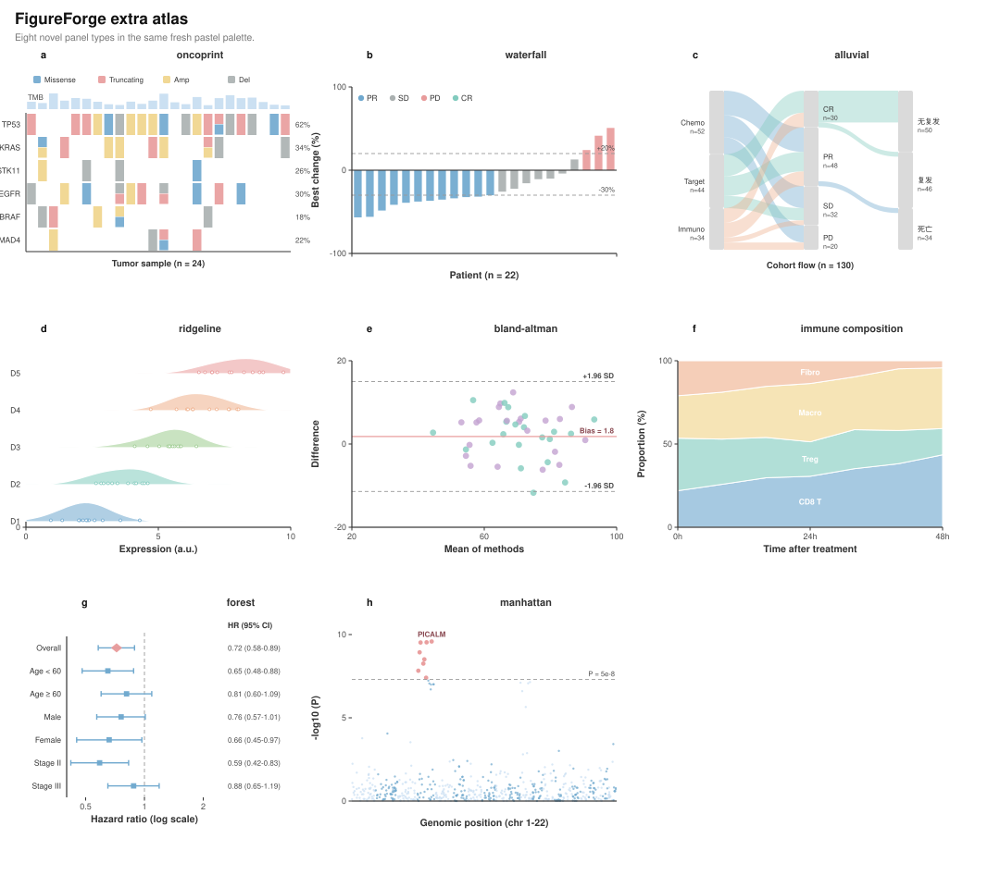
</div>

**Plus atlas (new)** — chord diagram, UpSet, network graph, ternary plot, clustered heatmap, treemap, sunburst, hexbin density, parallel coordinates: 9 advanced compositions:

<div align="center">
  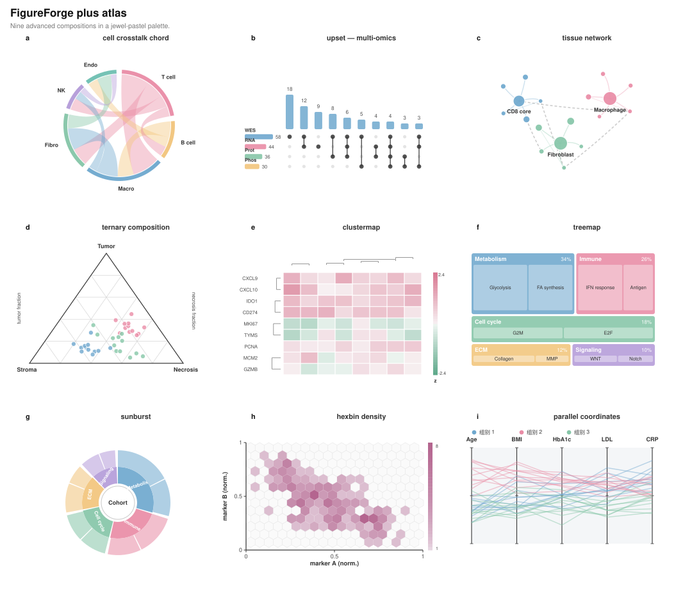
</div>

**Ultra atlas (new)** — Circos ring diagram, QQ plot, KM survival curves with risk table, raincloud, GO lollipop, Venn diagram, Gantt chart, radial dendrogram, sequencing-coverage tracks:

<div align="center">
  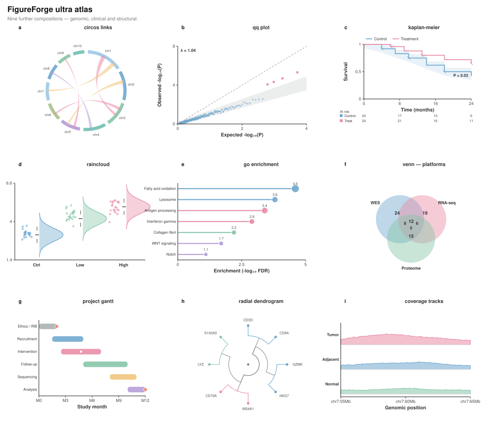
</div>

**Max atlas (new)** — scatterplot matrix, MA plot, pathway dot plot, circle packing, bump chart, 2D contour density, dumbbell plot, diverging stacked bars, calendar heatmap:

<div align="center">
  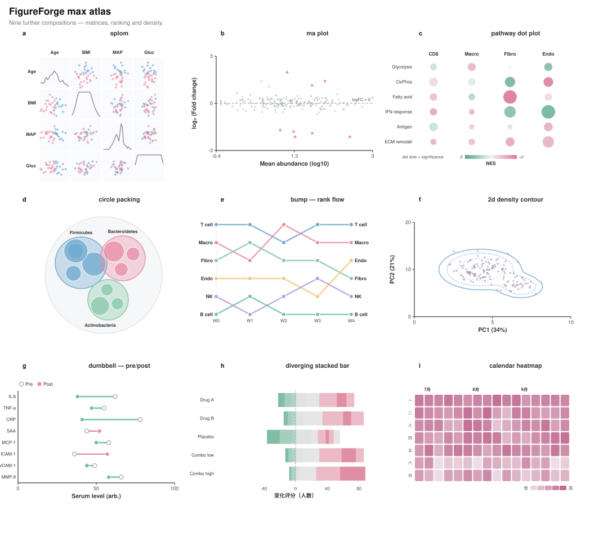
</div>

**Nova atlas (new)** — Sankey flow, chord correlation diagram, mosaic plot, PCA biplot, population pyramid, ring heatmap, dual-axis combo, pseudo-3D response surface, ECDF with KS test:

<div align="center">
  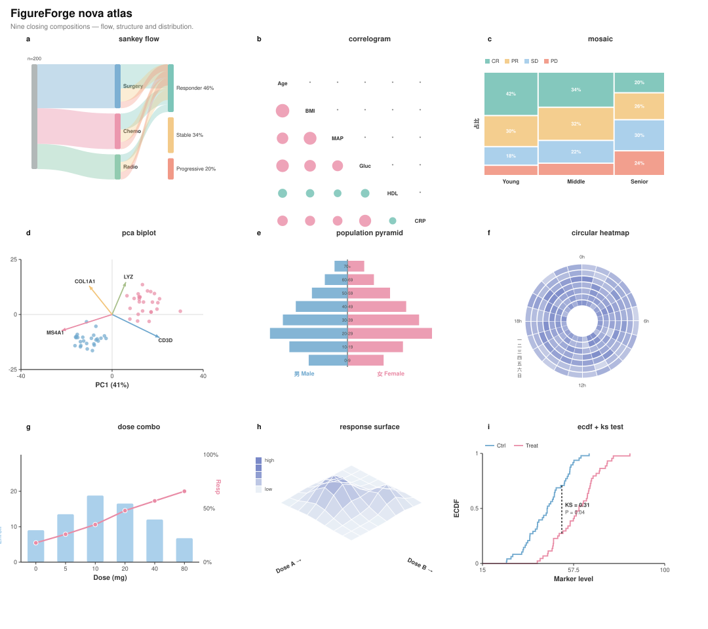
</div>

**Apex atlas (new)** — funnel plot, Taylor diagram, arc diagram, icicle chart, beeswarm, cycle plot, horizon chart, bullet chart, waffle chart:

<div align="center">
  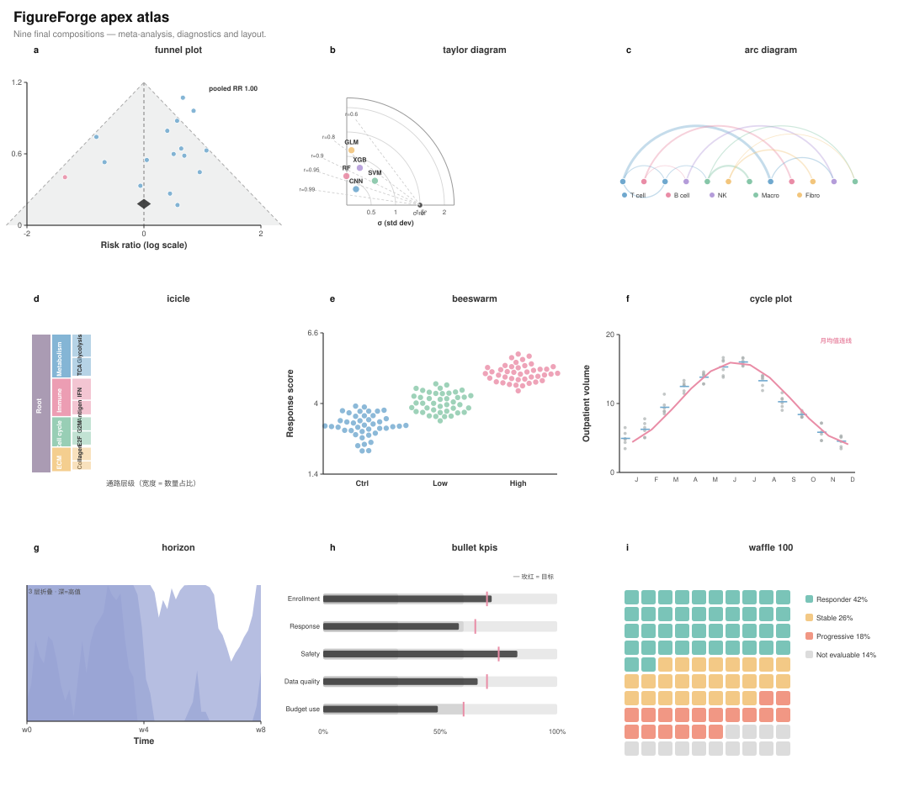
</div>

## 🧪 FigureForge — figure-making without code

**Open online (nothing to install)**: [jing1312.github.io/nature-figure-skill/figureforge/](https://jing1312.github.io/nature-figure-skill/figureforge/)

<div align="center">
  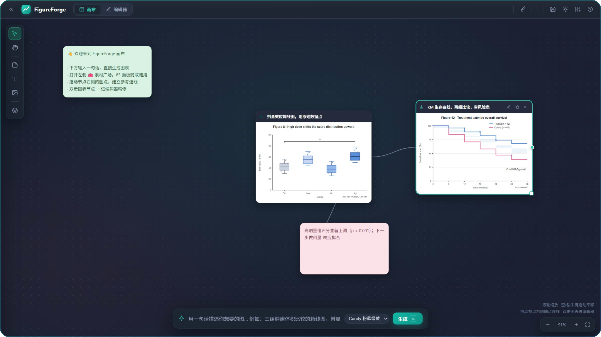
  <br/>
  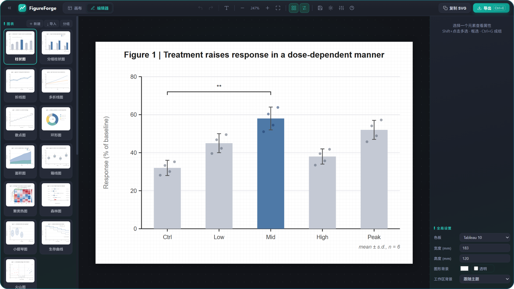
</div>

### Core capabilities

- **Infinite canvas (VibePaper-style workspace)**: generate a chart onto the canvas with one sentence; arrange chart / image / sticky-note / text node cards freely and drag ports to create reference links; the asset plaza ships 9 atlases with 83 panels ready to grab; double-click a card to refine it in the editor and changes write back automatically.
- **22 publication-grade templates**: bars (superplot raw-dot overlay), clustered heatmap (row/column dendrograms + diverging scale), volcano plot, forest plot, KM survival curves, violin, box plots, multi-panel composites… all pre-set to submission standards with error bars, significance brackets, confidence bands and legend placement.
- **16 curated palettes**: Tableau 10, Tol Muted, Economist, Morandi, macaron, Candy pink-blue-green-yellow-purple, Berry blue-purple-pink family, and more; **series-linked recoloring** — change one color and every data point, legend entry and colorbar in that series updates in sync, with one-step undo for the whole group.
- **Figma-grade editing**: smart guide snapping (<kbd>Alt</kbd> temporarily disables), Shift+click / marquee multi-select, Ctrl+G grouping, corner-handle resize, arrow-key nudging, full undo/redo; multi-selection pops up an **align / distribute** toolbar, the **format painter** copies styles in one click, and **imported external SVGs are split into per-element editable shapes** (nested transform groups hit precisely).
- **Bitmap editing kit**: drag in or Ctrl+V paste a screenshot onto the canvas, then crop by double-click, rotate 90°, flip, and adjust brightness/contrast/saturation.
- **Day & night themes**: ☀ / 🌙 one-click toggle with a full-screen starfield transition; 14 workspace backgrounds to choose from.
- **Session autosave**: edits persist to the browser in real time — close the page and pick up where you left off; projects can also be exported as `.json`.
- **Multi-format export**: SVG (text stays editable) / PNG / TIFF (with dpi metadata, submission-ready) / PDF (vector, selectable text) / PPTX, at 1×–4× scale and 300/600 dpi.

How it relates to the AI workflow: FigureForge doesn't replace code-driven figure-making — it covers both ends, **up-front layout design** (fix the skeleton before filling data) and **final tweaking** (drag an AI-generated figure into place).

## 🤖 nature-figure — Agent-skill figure workflow

Load SKILL.md into your agent (Claude Code, Codex, etc.) and figure-making turns from "one-off scripts" into "an auditable production line":

```text
figure contract → backend gate → single-backend render → layout & QA → independent export → delivery checklist
```

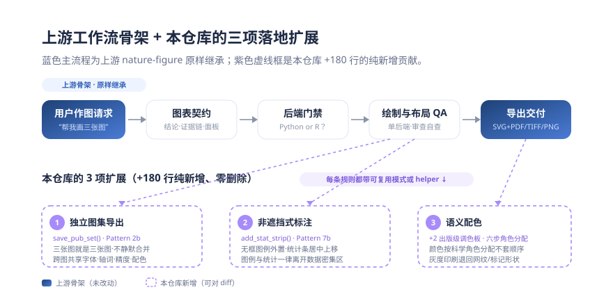

The workflow enforces three hard rules, mapped to the three biggest sources of figure rework:

**① Independent figure-set export** — three figures are three figures; never silently merge them into one. The whole set shares fonts, axis wording, color semantics and statistical precision.

```python
def save_pub_set(fig, out_dir, stem, dpi=600):
    fig.savefig(out_dir / f'{stem}.svg',  bbox_inches='tight')  # primary: editable
    fig.savefig(out_dir / f'{stem}.pdf',  bbox_inches='tight')  # TrueType embedded
    fig.savefig(out_dir / f'{stem}.tiff', dpi=dpi, bbox_inches='tight')  # print
    plt.close(fig)
```

**② Non-occluding annotation** — legends and stat boxes always stay out of data-dense regions; stat strips are frameless and quieter than the data:

```python
ax.legend(loc='center left', bbox_to_anchor=(1.02, 0.5), frameon=False, fontsize=6)
add_stat_strip(ax, 'Pearson r = 0.83, n = 46')   # built-in helper
```

**③ Semantic color** — color is a scientific language: assign roles first (primary method / control / threshold / background), then encode by significance; a user-provided color list is a "palette direction", not a sequence to apply in order.

<div align="center">
  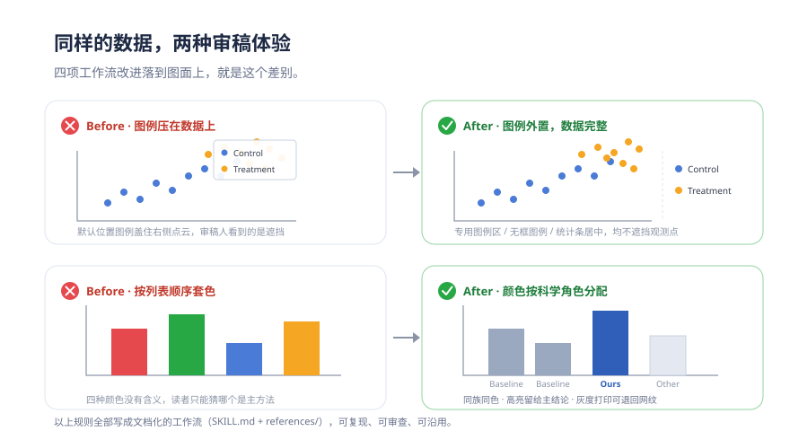
</div>

## 🚀 Quick start

**Browser (zero install)**: open the [online FigureForge](https://jing1312.github.io/nature-figure-skill/figureforge/), pick a template and start dragging.

**Hand it to your agent**:

```text
Please install this Agent Skill: https://github.com/jing1312/nature-figure-skill
Review the repository contents and SKILL.md first, then install the whole directory into your current agent's Skills directory.
When done, report the actual installation path and verification result.
```

**Manual install** (copy the whole directory — the skill depends on `references/` and other files):

```bash
git clone https://github.com/jing1312/nature-figure-skill.git
cd nature-figure-skill
mkdir -p ~/.codex/skills
cp -R skills/nature-figure ~/.codex/skills/    # main skill, full extensions
```

See [`install.md`](install.md) for details.

## 📦 Deliverables

Not "one bitmap" — **a submission-grade file set for every figure**:

```text
figure-01.svg    ← primary: text stays editable, journals can reword directly
figure-01.pdf    ← TrueType embedded, submission companion
figure-01.tiff   ← 600 dpi, meets most journals' print requirements
figure-01.png    ← preview / slides
```

## 🗺 Roadmap

- [x] 22 publication-grade templates + 16 curated palettes
- [x] Day/night themes / bitmap editing kit / series-linked recoloring / full undo-redo
- [x] Multi-line text editing (tspan line breaking)
- [x] Vector PDF export (svg2pdf.js + jsPDF, text stays selectable)
- [x] Radar, effect-size funnel, Gantt timeline and other new figure types (shipped with the 9 atlases / 83 panels in the asset plaza)
- [ ] Bar hatch / dot-pattern fills (print-friendly black & white)
- [ ] FigureForge ↔ Python pipeline loop (editor SVG → `save_pub_set` one-click PDF/TIFF backfill)
- [ ] Journal spec presets: 89 / 183 mm column-width checks, minimum font-size checks
- [ ] Color-vision deficiency simulation preview
- [ ] GitHub Actions: template XML validity + syntax gates

## 📚 Research skill pack bundled with this repo

<details>
<summary>Nine <code>nature-*</code> skills (click to expand)</summary>

Each `skills/nature-*` is an independently installable unit; **copy the whole directory** when installing.

| Skill | Status | Purpose |
| --- | --- | --- |
| [`nature-figure`](skills/nature-figure/README.md) | Stable | Python / R publication-figure workflow (**this repo's main extension**) |
| [`nature-polishing`](skills/nature-polishing/README.md) | Stable | Academic text polishing |
| [`nature-writing`](skills/nature-writing/README.md) | Draft | Manuscript section drafting and restructuring |
| [`nature-citation`](skills/nature-citation/README.md) | Beta | Literature search and reference export |
| [`nature-data`](skills/nature-data/README.md) | Draft | Data availability and FAIR metadata guidance |
| [`nature-reader`](skills/nature-reader/README.md) | Beta | Bilingual (EN/中文) close reading of papers |
| [`nature-response`](skills/nature-response/README.md) | Beta | Point-by-point reviewer response |
| [`nature-paper2ppt`](skills/nature-paper2ppt/README.md) | Beta | Chinese research-paper presentation PPT |
| [`nature-academic-search`](skills/nature-academic-search/README.md) | Beta | Multi-source literature search and reference management |

</details>

## 🔍 Derivative transparency

<details>
<summary>Relationship to upstream <code>Yuan1z0825/nature-skills</code> (click to expand)</summary>

The `nature-figure` workflow in this repo extends the baseline [`f3941a1`](https://github.com/Yuan1z0825/nature-skills/commit/f3941a1722e39af78b24bc7a34167b8880629545) of [`Yuan1z0825/nature-skills`](https://github.com/Yuan1z0825/nature-skills) (Yuan Yizhe and contributors, MIT); the [`FigureForge`](figureforge/) editor is original to this repo. Upstream MIT license and attribution are preserved in [`LICENSE`](LICENSE) and [`DERIVATIVE_NOTICE.md`](DERIVATIVE_NOTICE.md).

File-level changes of the initial derivative commit [`11fc2b8`](https://github.com/jing1312/nature-figure-skill/commit/11fc2b84a4fcd4f035b7a6f32045a9b2832c6a12) (auditable):

| File | Local contribution |
| --- | --- |
| [`SKILL.md`](skills/nature-figure/SKILL.md) | Three workflow rules: independent figure-set export, non-occluding annotation, semantic role color |
| [`references/api.md`](skills/nature-figure/references/api.md) | Two publication-grade palettes; `add_stat_strip()` frameless stat-strip helper |
| [`references/common-patterns.md`](skills/nature-figure/references/common-patterns.md) | External-legend pattern; Pattern 2b independent figure-set export (`save_pub_set()`); semantic color details |
| [`references/design-theory.md`](skills/nature-figure/references/design-theory.md) | Six-step color-role assignment workflow |

Reproduce the audit:

```bash
git clone https://github.com/Yuan1z0825/nature-skills && git -C nature-skills checkout f3941a1
git clone https://github.com/jing1312/nature-figure-skill && git -C nature-figure-skill checkout 11fc2b8
diff -r nature-skills/skills/nature-figure nature-figure-skill/skills/nature-figure
```

</details>

## 📄 License & acknowledgments

- The **FigureForge editor** and this repo's documentation and template extensions © jing1312, released under the MIT license.
- The `nature-*` skill content is derived from [Yuan1z0825/nature-skills](https://github.com/Yuan1z0825/nature-skills) © Yuan Yizhe and contributors, MIT license; original copyright notice preserved in [`LICENSE`](LICENSE).
- Issues and PRs are welcome — or make your next submission figure with the [online editor](https://jing1312.github.io/nature-figure-skill/figureforge/).
